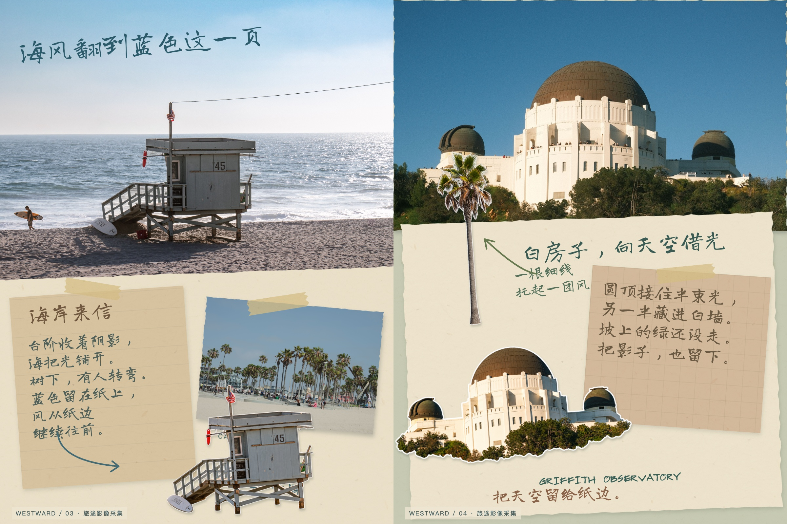
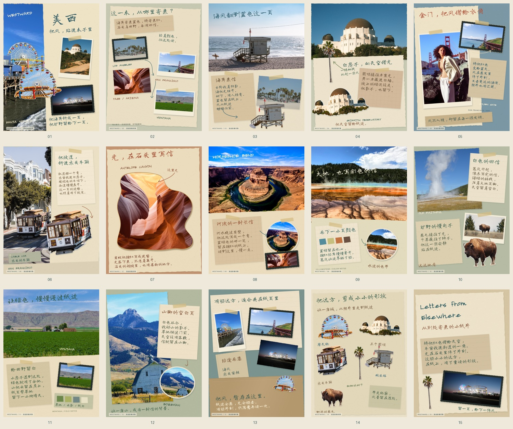
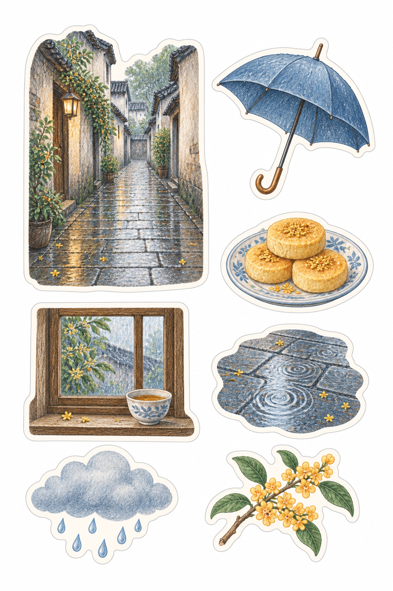
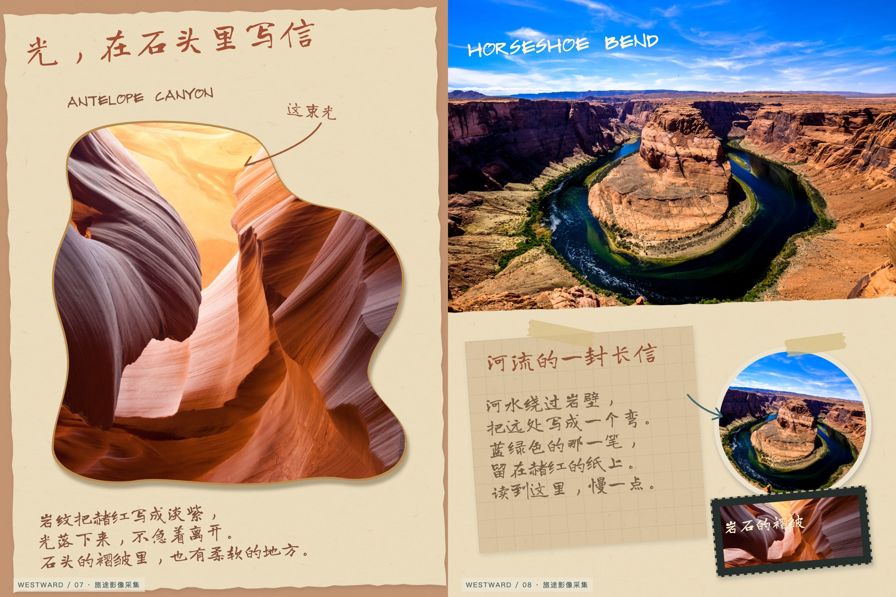

<div align="center">

# 旅行手帐·Letters from Elsewhere

**把远方的光，贴成可以重读的小纸片。**

A travel scrapbook skill for Codex — photographs, handmade stickers, and letters from the road.

[翻阅美西手帐](https://carpediem67.github.io/letters-from-elsewhere/) · [看制作过程](https://carpediem67.github.io/letters-from-elsewhere/process.html) · [下载 v1.0.0](https://github.com/carpediem67/letters-from-elsewhere/releases/tag/v1.0.0) · [安装](#安装)

</div>



海岸折成一页，旷野留给下一页。把旅行里的照片、地标和小物，整理成带有纸片层次、专属贴纸与文学旁注的电子手帐。电脑上摊开双页，手机上逐页读；整页图片可以保存，整本网站可以分享。

也可以只做一枚贴纸，或一张能剪下来贴进实体本子的贴纸页。

## 一册美西，十五页小纸片

**15 张真实摄影 · 6 枚照片衍生贴纸 · 15 页手帐**。洛杉矶海岸与格里菲斯天文台、旧金山金门桥与缆车、羚羊峡谷、马蹄湾、黄石与蒙大拿田野。



这是一册公开摄影素材演示，摄影来自不同作者，不代表同一位旅客的真实行程。原照片保留自然光与人物；贴纸由图像工具编辑，属于可能重绘细节的衍生创作，不承诺逐像素精确抠图。摄影作者、许可与页面用途见 [来源清单](examples/western/SOURCES.md)。

- [在线翻阅](https://carpediem67.github.io/letters-from-elsewhere/)：桌面双页、手机单页，按钮与方向键翻页。
- [下载离线 HTML](https://github.com/carpediem67/letters-from-elsewhere/releases/download/v1.0.0/western-journal.html)：约 43 MB，下载后用浏览器打开，无需联网阅读。
- [下载 15 页 PNG](https://github.com/carpediem67/letters-from-elsewhere/releases/download/v1.0.0/letters-from-elsewhere-west-15-pages.zip)：每页 **1200 × 1600**，与阅读器使用同一份画面。
- [制作过程与设计取舍](examples/western/PROCESS.md)：摄影输入、贴纸、成页、文案修订和实际提示词。

## 安装

下载 Release 中的 [trip-journal-stickers-v1.0.0.zip](https://github.com/carpediem67/letters-from-elsewhere/releases/download/v1.0.0/trip-journal-stickers-v1.0.0.zip)，解压到 Codex 的 Skill 目录：

```text
~/.agents/skills/trip-journal-stickers/
├── SKILL.md
├── agents/
├── references/
└── scripts/
```

重新加载 Codex 后用 `$trip-journal-stickers` 调用，展示名称为「旅行手帐·Letters from Elsewhere」。安装包只包含 Skill 与必要脚本，不含整本展示图片；仓库另外保留案例和可编辑源稿。

也可以克隆仓库到 `~/.agents/skills/trip-journal-stickers`；根目录即 Skill 入口。

### 所需环境

可查看照片、执行脚本的 Codex；可用的图像生成/编辑工具；Python 3.11+ 与 Pillow；可导出整页 PNG 的浏览器。内置 `image_gen` 可用时优先使用，无需另配 API Key。缺少图像工具时可整理照片和准备提示词，不能把它算作已经制作了专属贴纸。

照片整理依赖：

```bash
python3 -m venv .venv
source .venv/bin/activate
python -m pip install -r requirements.txt
```

翻阅器打包只使用 Python 标准库。HEIC/HEIF 是否可读取决于当前解码支持；不支持时先转换副本，不修改原片。

## 开始制作

### 一本手帐

```text
使用 $trip-journal-stickers，把这个文件夹里的旅行照片做成一本手作旅行手帐。
想留住海岸、路上的小物和同行人的瞬间。
要专属贴纸、撕纸、纸窗和可读的手写旁注；文案有一点文学感。
整本能翻阅，每页能保存图片。
```

可以补充日期、地点、原话与视觉参考。没有提供的关系、消费、日期或经历，不会为“真实感”编造。

### 一张贴纸页

```text
使用 $trip-journal-stickers，做一张雨天散步贴纸页。
青石板、蓝雨伞、桂花糕、窗边的茶杯。无字，彩铅与剪纸风。
```



[查看输入、提示词与修订](examples/rainy-walk-prompt.md)。这个例子是主题创作，未使用真实旅行照片。

## 它怎样工作

**查看素材 → 选片与分章 → 提取具体物件 → 制作专属贴纸 → 逐页排版与写作 → 检查 → 打包分享。**

照片保持现场感，贴纸参与纸页构图；纸片、胶带、毛边、折页与口袋各有材料区别。正文独立排版，让中文笔迹可读。文学感从照片里的细节出发，不套用万能旅行金句。



Agent 负责观察、选片、写作与艺术排版；脚本负责整理和打包。它需要实际查看成图与修正，不是固定模板的一键相册。

| 交付 | 用途 |
| --- | --- |
| 排版源稿 | 修改文字、布局与素材 |
| `pages/*.png` | 整页分享图片，默认 3:4 |
| `journal.html` | 单文件离线翻阅，可部署到静态网站 |
| `journal.pages.zip` | 全部页面图片 |

已有排好的页面可直接打包：

```bash
python3 scripts/build_scrapbook.py ./pages \
  --output ./journal.html \
  --title '沿途的小事'
```

默认内嵌全部页图，ZIP 下载在浏览器里复用同一份 PNG。静态网站可使用 `--linked-pages pages`，把页图放在 HTML 旁的 `pages/` 中；这个模式需要一起部署目录，不能只拷贝 HTML 离线阅读。

## 阅读与分享

先看作品，再看 [过程说明](examples/western/PROCESS.md)。本样册展示了摄影保留、六种物件衍生贴纸、材料叠放、纸窗、照片口袋、色彩采集和文学旁注。

已检查全部单页与跨页，实际验证桌面浏览器、390 × 844 移动尺寸下的翻页及 PNG/ZIP 下载。没有完成微信、小红书客户端和实体打印验收；应用内下载支持可能不同，可使用系统浏览器或长按保存。

网页中的手帐文字已经渲染为图片，修改需回到排版源稿。离线文件随页数增大。分享网址需要部署；Skill 只在用户授权后发布，不自动发朋友圈或小红书。

把个人相册放在 Skill 目录之外。制作专属贴纸时，输入可能由当前图像工具处理；离线阅读不等于制作过程完全离线。带本地路径或 EXIF 的照片清单保留本地，公开前还需检查画面内的隐私。

## 创作标准与许可

- [Skill 入口](SKILL.md)：贴纸与整本手帐的路由和交付边界。
- [手作视觉](references/visual-standard.md) · [拼贴流程](references/scrapbook.md) · [照片整理](references/travel-journal.md)。
- [写作标准](references/writing.md) · [贴纸画面说明](references/art-direction.md) · [展示与过程记录](references/showcase.md)。
- [美西源稿与重建](examples/western/README.md)。

代码与 Skill 文本采用 [MIT License](LICENSE)。摄影、衍生图像与 Long Cang 字体分别按 [素材说明](NOTICE.md) 处理；摄影不归入 MIT，图中人物与品牌不为产品代言。贴纸不附带矢量刀模，打印清晰度以实际像素和目标尺寸为准。
